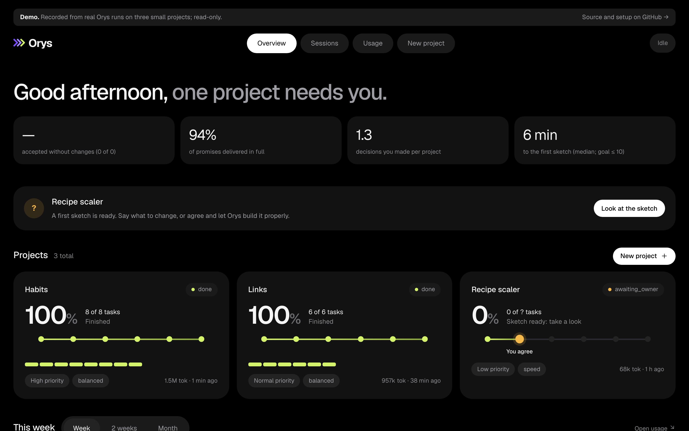
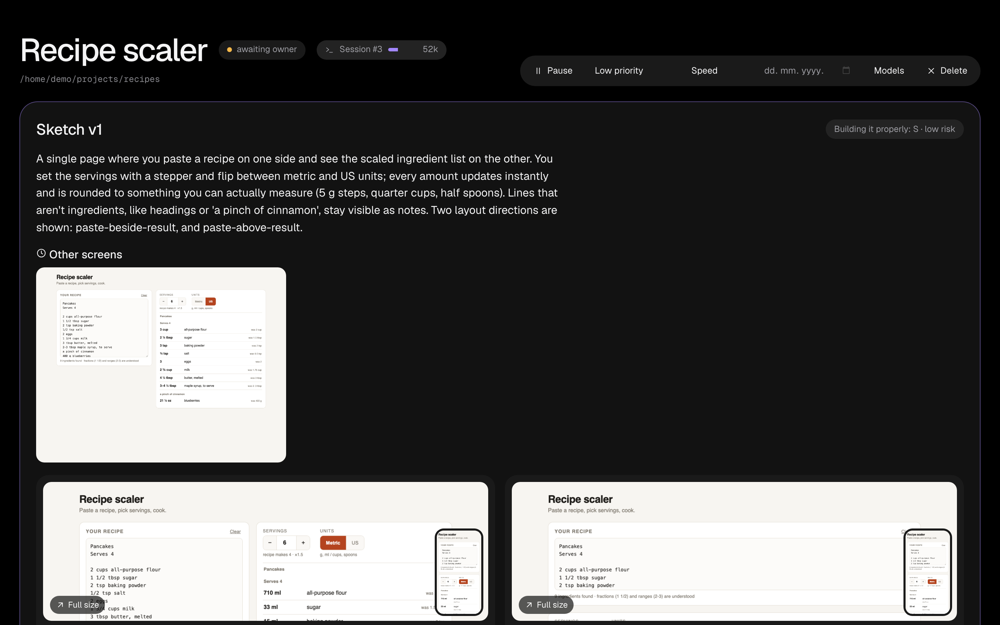
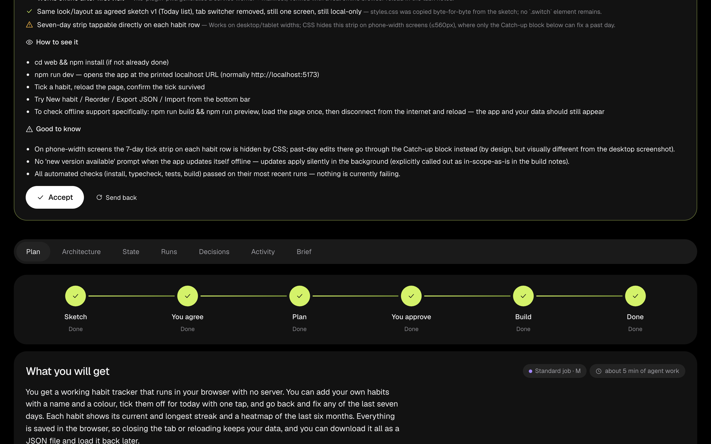
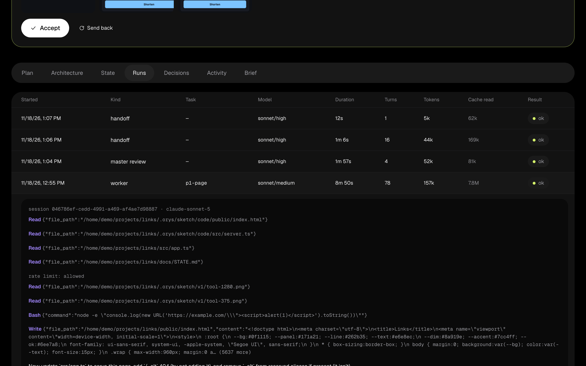
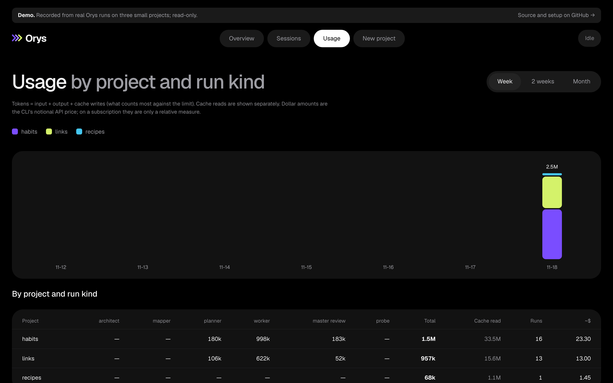
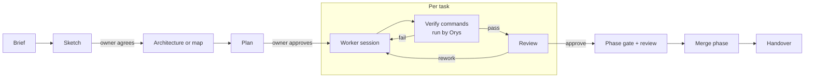

# Orys

[](https://github.com/ristic583/orys/actions/workflows/ci.yml)


**A project manager for Claude Code.** You describe what you want built; Orys sketches it so you can see it within minutes, plans it in phases and tasks, has Claude Code sessions build it task by task, checks every step with real commands, reviews it, and hands it over with screenshots. It runs on your computer, with your Claude subscription, and picks up exactly where it stopped when the subscription's limit is reached.

**[Look around the demo →](https://orys-demo.stefanristic.com)** The real dashboard on recorded data from three small projects Orys built from scratch: a habit tracker, a URL shortener and a recipe scaler waiting for its sketch to be approved. Read-only.

<p align="center"></p>

<table>
  <tr>
    <td width="50%"></td>
    <td width="50%"></td>
  </tr>
  <tr>
    <td><b>Sketch first</b>: something to look at within minutes, in two or three directions, with what is real and what is faked.</td>
    <td><b>Handover</b>: an independent agent checks every promise against the code and screenshots; you accept it or send it back.</td>
  </tr>
  <tr>
    <td width="50%"></td>
    <td width="50%"></td>
  </tr>
  <tr>
    <td><b>Runs</b>: every Claude Code session with its transcript, tools, tokens and result.</td>
    <td><b>Usage</b>: measured per project, per day and per kind of run, never estimated.</td>
  </tr>
</table>

## How it works



- **Master = code, plus an LLM only for decisions.** Scheduling, state machines, checks, limits and usage are deterministic TypeScript; Claude is asked to architect, plan, build and review, always with a fresh, compact snapshot of the state.
- **Verification is not an opinion.** A task is done when its verify commands exit with 0, run by Orys, not when the worker says so. A failure that already existed before the task is detected by re-running the command on the task's base commit, so nobody burns attempts on someone else's bug.
- **Everything resumes.** A limit, a crash or a restart leaves every task in a state it continues from; the session id is stored the moment a run starts, so even a hard kill resumes the same Claude session.
- **Limits are read, not guessed.** Claude Code's stream reports `rate_limit_event`s; Orys waits for the reset and probes with the cheapest possible call before going on.
- **Three ways in:** a new project from scratch, an existing repository to continue (a mapper agent proposes what to do), or a rework (redesign, refactor, tests, performance, security, upgrades) with frozen behaviour protected by characterisation tests first. Existing code can be worked on in place on branches, or on a sealed copy that never touches the original.
- **Remote access without opening a port:** the dashboard can be reached through a relay while all work stays on your computer; risky actions still need a click on the computer itself.

The full design is in [SPEC.md](SPEC.md); the prompts are in [`prompts/`](prompts).

## Run it

Needs Node 22+, pnpm, git and [Claude Code](https://docs.anthropic.com/en/docs/claude-code) signed in to your subscription.

```bash
pnpm install
```

```bash
pnpm build
```

```bash
pnpm orys serve
```

Open <http://localhost:4317> and create a project with the wizard, or from a brief file:

```bash
pnpm orys project new -f examples/links.yaml
```

Projects live in `~/aipm-projects/<slug>` (`AIPM_PROJECTS_DIR`); Orys's own state is in `data/`. Workers run Claude Code with `bypassPermissions` inside their project folder, so try it on projects you are comfortable letting an agent change, or use the "work on a copy" mode for existing code.

### Tests

```bash
pnpm typecheck && pnpm test
```

The loops and the scheduler are tested against a fake Claude client that replays recorded and scripted runs, limits included, so the suite spends no tokens. `pnpm test:live` runs a few real (haiku) calls.

### The demo build

`pnpm demo:snapshot http://127.0.0.1:4317` records every response the dashboard needs from a running Orys into `web/demo-public/` (local paths replaced); `pnpm build:demo` builds the dashboard against that recording into `web/dist-demo/`, a static site.

## Repository map

| Path | What is there |
|---|---|
| `src/core` | Types, state machines, profiles, outcome and process rules (pure functions) |
| `src/claude`, `src/runs` | The Claude Code client, output parsing, limit detection and the run recorder |
| `src/loops` | Sketch, mapper, architect, planner, worker, review and handover |
| `src/scheduler` | Per-project loops, the global limit wait and probe |
| `src/projects`, `src/sessions` | Briefs, repositories, sandbox copies, plan editor, owner decisions, project sessions |
| `src/server`, `web` | Fastify API with server-sent events, and the React dashboard |
| `src/relay`, `src/hub` | Remote access (relay, agent, pairing, route allow-list) and the multi-user hub |
| `prompts` | Prompt templates |
| `tests`, `fixtures` | Vitest suites and recorded Claude Code output |

## License

Orys is source-available under the [PolyForm Noncommercial License 1.0.0](LICENSE): free to read, run, change and share for any non-commercial purpose. Commercial use needs separate permission from the author; reach me through my [GitHub profile](https://github.com/ristic583).
